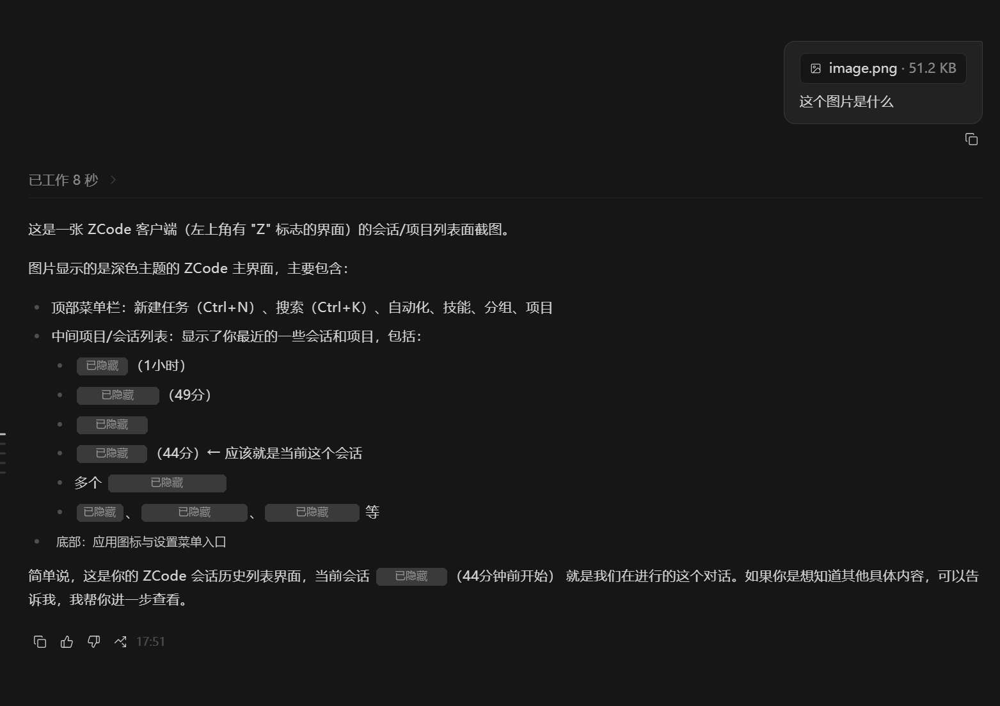

# DeepSeek Vision Proxy — 给纯文字 DeepSeek 装上识图眼睛

> 一个本地识图代理，让 DeepSeek 等纯文字模型能"看图"。图片被自动交给智谱免费视觉模型（GLM-4V-Flash）识别成文字，再喂给 DeepSeek 回答。全自动，装好即用，识图永久免费。



[English](#english) · [中文](#中文)

## 为什么需要它

DeepSeek 官方 API 是**纯文字模型，不支持图片输入**。你发图它只会说"看不了图片"。本方案在中间加一层本地代理：

```
你发图 → 本地代理(127.0.0.1:8777) → 智谱GLM-4V识别成文字 → DeepSeek看文字回答
```

- **DeepSeek 永远收到文字** → 永远不瞎编、不说"看不了"
- **不靠模型自觉** → 代理强制拦截，发图即识别
- **识图免费** → 用智谱 `glm-4v-flash`（官方免费模型）
- **多图支持** → 一次发多张，分批识别、一一对应

## 兼容性

✅ **ZCode**（重点支持）· **Claude Code** · 任何支持自定义 baseURL 的 OpenAI 兼容客户端

## 安装（约 1 分钟）

### Windows 一键安装

1. 下载本仓库，解压得到 `see-vision` 文件夹
2. 双击 **`安装.bat`**（或运行 `python install.py`）
3. 按提示填两个 key：
   - **智谱 key**（免费识图）：去 [open.bigmodel.cn](https://open.bigmodel.cn) 注册 → 控制台 → API密钥
   - **DeepSeek key**：去 [platform.deepseek.com](https://platform.deepseek.com) 注册
4. 安装脚本自动完成：复制文件 → 写密钥 → 改 ZCode/客户端配置 → 设开机自启 → 启动代理

### 手动安装（可选）

```bash
# 1. 复制文件
cp see_proxy.py see_proxy_watchdog.py see.py config.example.json ~/.zcode/skills/see-vision/
# 2. 填配置
cp see_proxy_config.example.json see_proxy_config.json   # 填入两个 key
# 3. 启动代理
python see_proxy.py
# 4. 把 DeepSeek 的 baseURL 改成 http://127.0.0.1:8777/v1
```

## 如何申请 Key（必读）

安装时需要两个 key，都在官方平台免费申请，几分钟搞定。

### ① 智谱 Key（免费识图）

用智谱 `glm-4v-flash` 视觉模型识别图片，**免费**。

1. 打开 [智谱开放平台 open.bigmodel.cn](https://open.bigmodel.cn)（认准域名 `open.bigmodel.cn`）
2. 右上角 **注册**（手机号即可，个人实名免费）
3. 登录后进 **控制台** → 左侧菜单找 **API 密钥**
4. 点 **新建密钥**，会生成一串类似 `xxxxxxxx.xxxxxxxx` 的 key（点复制保存）
5. 粘贴到安装向导的"智谱 key"输入框

> 免费额度：智谱新用户送免费 tokens，识图模型 `glm-4v-flash` 本身免费，日常看图够用。

### ② DeepSeek Key（主模型）

DeepSeek 官方 API key，用于最终回答问题。

1. 打开 [DeepSeek 开放平台 platform.deepseek.com](https://platform.deepseek.com)（认准域名 `platform.deepseek.com`）
2. **注册**并登录（支持手机号/邮箱）
3. 进 **控制台** → 左侧 **API Keys**
4. 点 **创建 API Key**，复制生成的 `sk-...` 开头的 key
5. 粘贴到安装向导的"DeepSeek key"输入框

> 注意：key 只显示一次，创建后立即复制保存。忘记只能重新创建。

### 两个 Key 都填好后

双击 `安装.bat` → 按提示粘贴两个 key → 重启 ZCode → 发图即可识别。

## 使用

装好后，在 ZCode / Claude Code 里：

1. **发图 + 提问**：粘贴/拖拽图片 + 问题，几秒返回准确内容
2. **多张图**：一次发多张也对应准确
3. 纯文字提问完全不受影响

## 文件说明

| 文件 | 作用 |
|---|---|
| `see_proxy.py` | 识图代理（核心），拦截图片 → 转文字 → 转发 DeepSeek |
| `see_proxy_watchdog.py` | 看门狗，代理挂了自动拉起 |
| `see.py` | 调视觉模型识图的脚本（智谱 GLM-4V-Flash） |
| `see_proxy_config.example.json` | 代理配置模板（填 key 用） |
| `config.example.json` | 识图配置模板 |
| `install.py` / `安装.bat` | 一键安装脚本 |
| `SKILL.md` | ZCode 技能定义 |

## 故障排查

| 现象 | 原因 | 解决 |
|---|---|---|
| 发图 DeepSeek 说"看不了" | 代理没跑 | 重新双击 `安装.bat`，或看 `see_proxy.log` |
| ZCode 报连接错误 | 代理没起来 | 检查 8777 端口，重启代理 |
| 识图慢 | 用了付费/慢模型 | 确认 `agnes_model` 是 `glm-4v-flash` |
| 换 key 不生效 | 配置缓存 | 改 `see_proxy_config.json` 后重启代理 |

## 卸载

1. 删除 `~/.zcode/skills/see-vision/` 文件夹
2. 删除启动目录的 `see-vision-watchdog.vbs`
3. 把 DeepSeek baseURL 改回 `https://api.deepseek.com/v1`

## 安全说明

- 代理只监听本机 `127.0.0.1:8777`，不对外暴露
- 密钥存本地配置文件，不上传、不提交（`.gitignore` 已排除）
- 图片只在本机识别，不进对话历史

## 许可证

[MIT License](LICENSE)

---

## English

# DeepSeek Vision Proxy — Give text-only DeepSeek the ability to see images

A local proxy that lets text-only models (like DeepSeek) "see" images. Images are auto-recognized by the free Zhipu GLM-4V-Flash vision model into text, then fed to DeepSeek. Fully automatic, install-and-go, vision is permanently free.

### Install (Windows, ~1 min)

1. Download & unzip this repo
2. Double-click **`安装.bat`** (or run `python install.py`)
3. Enter two keys when prompted:
   - **Zhipu key** (free vision): register at [open.bigmodel.cn](https://open.bigmodel.cn)
   - **DeepSeek key**: register at [platform.deepseek.com](https://platform.deepseek.com)
4. Done. Restart ZCode and send an image.

### How it works

```
You send image → local proxy (127.0.0.1:8777) → Zhipu GLM-4V recognizes → DeepSeek answers from text
```

### Compatible with

✅ **ZCode** (primary) · **Claude Code** · any OpenAI-compatible client with custom baseURL

### License

[MIT](LICENSE)
